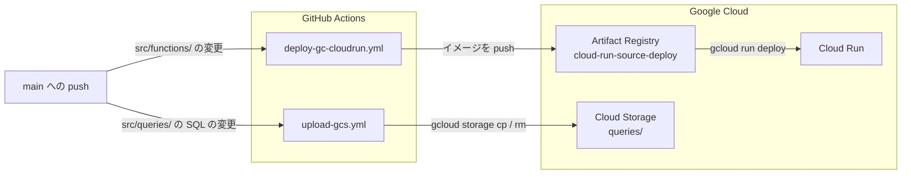

# google-cloud-practice

Google Cloud の Cloud Run・Workflows・Cloud Storage・BigQuery を試すためのリポジトリです。main ブランチへの push をきっかけに、GitHub Actions が Cloud Run へのデプロイと、SQL ファイルの Cloud Storage へのアップロードを行います。

## 構成

| パス | 内容 |
| --- | --- |
| `src/functions/<サービス名>/` | Cloud Run で動かす Python の HTTP 関数（[Functions Framework](https://github.com/GoogleCloudPlatform/functions-framework-python)）。ディレクトリ名が Cloud Run のサービス名になります |
| `src/queries/` | BigQuery で実行する SQL |
| `src/workflows/` | Workflows の定義。Cloud Storage から SQL を読み込み、BigQuery で実行します |
| `infra/` | Terraform。手順は [infra/README.md](infra/README.md) にあります |
| `.devcontainer/` | 開発用の Dev Container（gcloud CLI、Docker CLI、ruff、sqlfluff など） |
| `.github/workflows/` | デプロイとアップロードを行う GitHub Actions |

## デプロイの流れ



| ワークフロー | 実行される条件 | 処理 |
| --- | --- | --- |
| [deploy-gc-cloudrun.yml](.github/workflows/deploy-gc-cloudrun.yml) | main への push で `src/functions/` 以下が変わったとき | 変更があったサービスごとに、そのディレクトリの Dockerfile でイメージをビルドして Artifact Registry に push し、同じ名前の Cloud Run サービスにデプロイします |
| [upload-gcs.yml](.github/workflows/upload-gcs.yml) | main への push で `src/queries/` 以下の `.sql` が変わったとき | 追加・変更した SQL をアップロードし、削除した SQL はバケットからも削除します。名前を変えた SQL は、新しい名前でアップロードして古い名前のものを削除します。`src/queries/<パス>` は `gs://<バケット>/queries/<パス>` に置かれます |

Terraform（`infra/`）と Workflows（`src/workflows/`）を反映するワークフローはありません。

Google Cloud への認証には Workload Identity 連携を使います。GitHub リポジトリの Secrets に次の値を設定します。

| Secret | 使うワークフロー | 内容 |
| --- | --- | --- |
| `GC_WORKLOAD_IDENTITY_PROVIDER` | 両方 | Workload Identity プロバイダ |
| `GC_SERVICE_ACCOUNT` | 両方 | 認証に使うサービスアカウント。Cloud Run サービスの実行サービスアカウントにもなります |
| `GC_PROJECT_ID` | deploy-gc-cloudrun.yml | プロジェクト ID |
| `GC_REGION` | deploy-gc-cloudrun.yml | Artifact Registry と Cloud Run のリージョン |
| `GCS_BUCKET_NAME` | upload-gcs.yml | SQL のアップロード先のバケット名 |

## ローカルでの実行

Dockerfile があるサービス（api-service）は、イメージをビルドして起動できます。

```bash
cd src/functions/api-service
docker build -t api-service .
docker run -p 8080:8080 api-service
```

`http://localhost:8080/` にリクエストすると、Dockerfile の `CMD` で `--target` に指定した関数が応答します。

Dockerfile がないサービスは、仮想環境に依存をインストールしてから Functions Framework で起動します。

```bash
cd src/functions/worker-service
python -m venv .venv
. .venv/bin/activate
pip install -r requirements.txt
functions-framework --target main --port 8081
```
